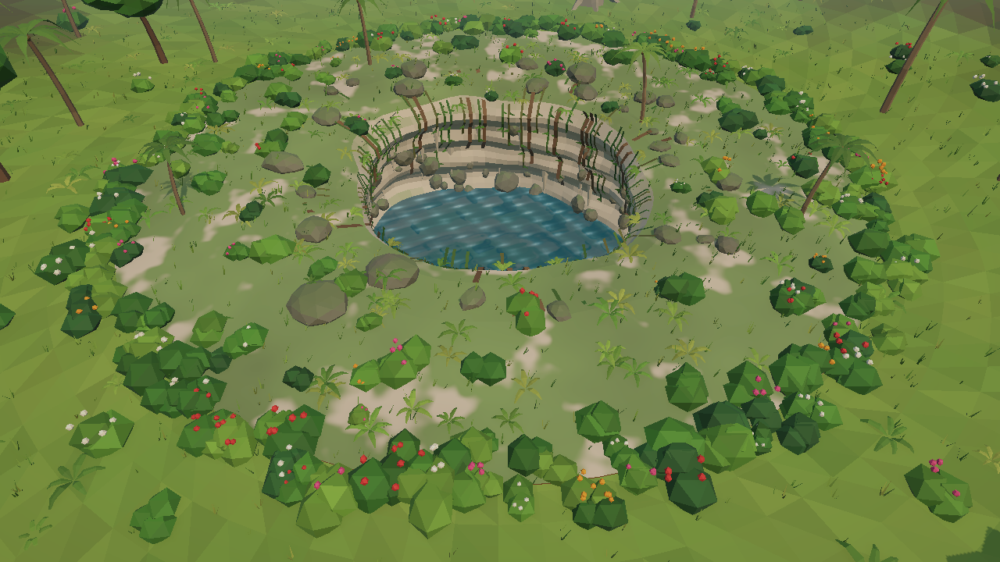
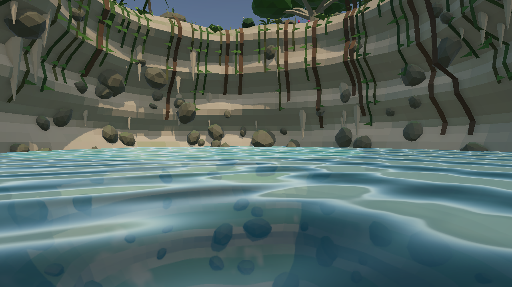
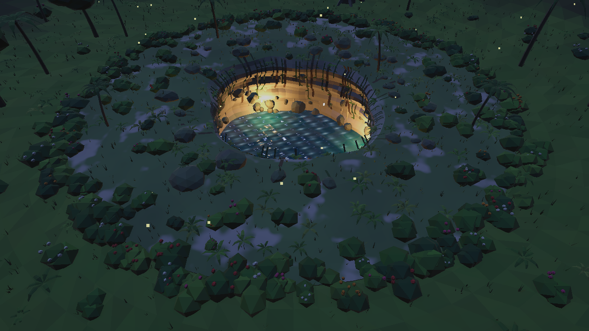
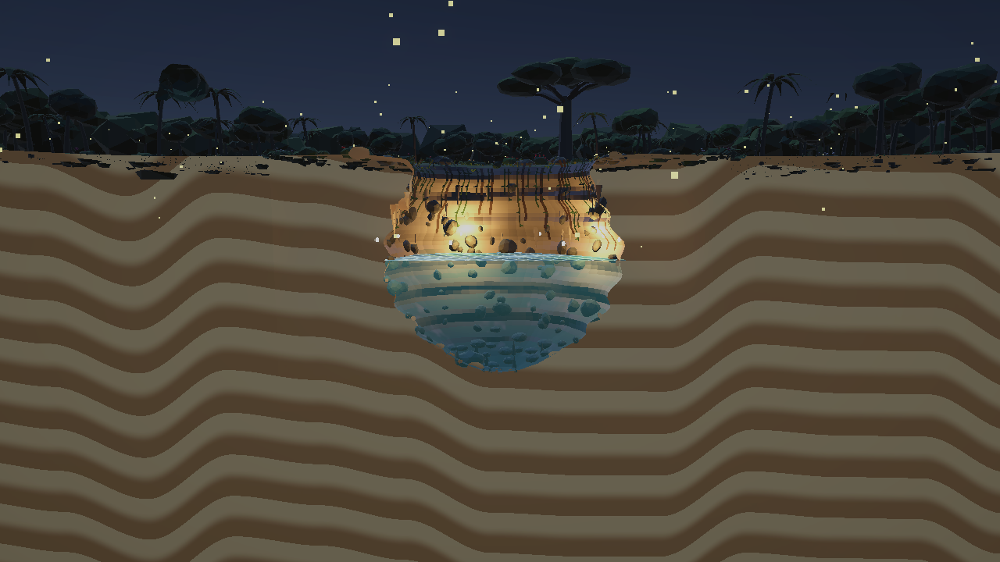
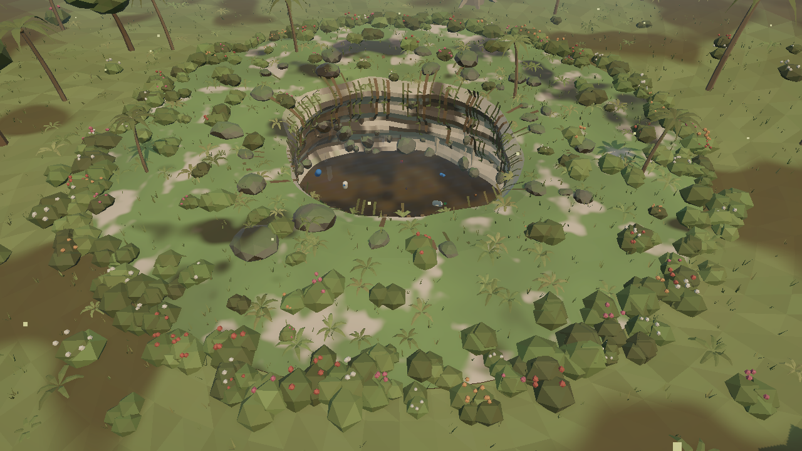
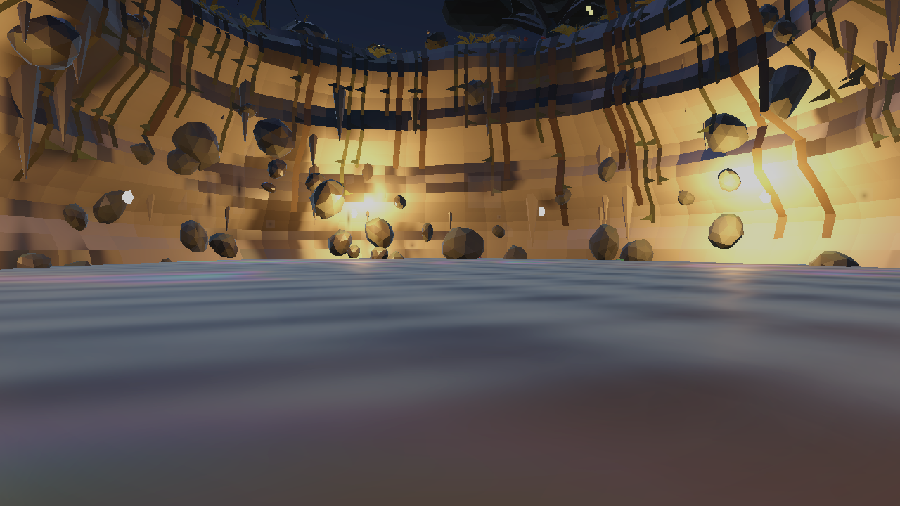
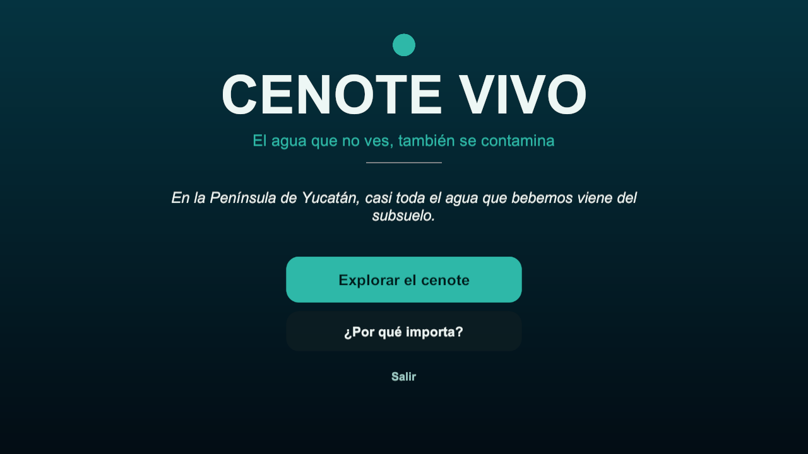

# Cenote Vivo — Guía del proyecto

App Android en Unity 6.6 (URP) para concientizar sobre la contaminación del agua subterránea y del subsuelo en los cenotes.
El modelo base es `Assets/Components/cenote-prueba-7.fbx` y se conserva tal cual. Todo lo nuevo se le agrega encima con materiales, partículas, cámaras y UI.

## Versión de realidad aumentada (rama `ar`)

Esta rama agrega una tercera escena, **CenoteAR**, con realidad aumentada (Vuforia Engine 11.4). Se abre desde el botón **«Ver en tu mesa (AR)»** del menú. Las escenas `MenuInicio` y `CenoteVivo` funcionan igual que en `main`.

**Funcionalidades**

1. **El cenote sobre la mesa.** El cenote aparece como una maqueta en miniatura sobre una mesa o el piso. Se coloca tocando la pantalla, se arrastra con un dedo, se escala pellizcando y se gira con dos dedos.
   - Si el teléfono admite Ground Plane (ARCore), detecta la superficie solo.
   - Si no, el cenote aparece sobre un **marcador impreso**: `Assets/CenoteVivo/AR/Marcador_CenoteVivo.png`, impreso a **20 cm de ancho**. A los 10 s sin superficie, la app también ofrece cambiar al marcador.
2. **Etiquetas informativas.** Roca caliza, agua subterránea, raíces y contaminación. Al tocar una se abre una tarjeta con una explicación corta.
3. **Foto con el cenote.** Captura la escena con un marco con el lema, la guarda en la galería (Imágenes › Cenote Vivo) y permite compartirla.

Además siguen funcionando, sobre la maqueta, el simulador de contaminación, el día/noche, el corte del subsuelo (que siempre mira hacia el usuario) y el panel informativo.

**Pensada para teléfonos de gama baja:** la selva se recorta a un diorama ligero, no hay sombras, el límite es de 30 FPS, la búsqueda de superficies se apaga al colocar el cenote y las etiquetas son UI de pantalla. Vuforia 11 exige **Android 10 (API 29)** como mínimo.

**Código:** `Assets/CenoteVivo/Scripts/Runtime/AR/` (`ColocadorAR`, `EtiquetasAR`, `FotoAR`, `GaleriaAndroid`, `EspacioCenoteAR`, `PantallaARController`) y `Scripts/Editor/CenoteVivoARBuilder.cs`. Los shaders reciben la matriz «mundo → espacio del cenote» (`_CenoteMundoALocal`), así que el corte, los estratos y el viento funcionan con la miniatura movida o escalada.

### Preparar el proyecto tras clonar

1. **Paquete de Vuforia.** No está en el repositorio porque pesa 138 MB y supera el límite de GitHub. Descarga **Vuforia Engine 11.4.4 para Unity** desde [developer.vuforia.com](https://developer.vuforia.com/downloads/sdk) y copia `com.ptc.vuforia.engine-11.4.4.tgz` en la carpeta `Packages/`. `Packages/manifest.json` ya lo referencia.
2. **Licencia de Vuforia.** Crea una *Basic license* gratuita en el portal de Vuforia y pégala en `Assets/Resources/VuforiaConfiguration.asset`, campo *App License Key*, desde **Vuforia Engine › Vuforia Engine Configuration**. En el repositorio la clave va vacía.
3. Menú **Cenote Vivo ▸ 1. Construir escenas** (arma también CenoteAR) y **Cenote Vivo ▸ 3. Compilar APK (AR)**, que genera `Builds/CenoteVivoAR.apk` con el id `com.cenotevivo.ar`.

## Herramientas utilizadas

| Herramienta | Uso en el proyecto |
|---|---|
| **Unity 6.6** (6000.6.3f1) con **URP** 17.6 | Motor del juego: escenas, interfaz (uGUI), iluminación, partículas, Lit Shader Graph, Profiler y compilación para Android |
| **Vuforia Engine** 11.4 | Realidad aumentada: Ground Plane (detección de mesa o piso), Image Target (marcador impreso) y anclas |
| **Blender** | Modelado del cenote 3D (`cenote-prueba-7.fbx`): roca caliza, piedras, corte del subsuelo, agua y sus tres niveles de detalle (LOD0–LOD2) |
| **Claude** (Anthropic) | Asistente de IA para programar los scripts en C#, las funciones de los Shader Graph, el generador de la selva, la optimización con el Profiler y esta documentación |

---

## 0. Cómo usarlo (rápido)

1. Menú de Unity: **Cenote Vivo ▸ 1. Construir escenas**. Crea o actualiza las dos escenas, los materiales, el LOD, las cámaras, las partículas y la UI. Lo puedes repetir las veces que quieras: solo reemplaza lo que él mismo generó y respeta los materiales `CV_*` que hayas ajustado a mano.
2. Menú **Cenote Vivo ▸ 2. Configurar proyecto para Android**. Aplica IL2CPP + ARM64, orientación horizontal y el id `com.cenotevivo.app`.
3. **File ▸ Build Profiles ▸ Android ▸ Switch Platform**. Necesitas el módulo de Android instalado en Unity Hub.
4. Abre `Assets/CenoteVivo/Scenes/MenuInicio.unity` y pulsa **Play**.

> `Assets/Scenes/SampleScene.unity` queda intacta como respaldo. La escena de trabajo es una copia: `CenoteVivo.unity`.

---

## 1. Estructura del proyecto y flujo de pantallas

### 1.1 Carpetas

```
Assets/
├─ Components/
│  └─ cenote-prueba-7.fbx          ← modelo base (LOD0/LOD1/LOD2 + agua). No se modifica.
├─ Scenes/SampleScene.unity        ← escena original (respaldo)
└─ CenoteVivo/
   ├─ Scenes/
   │  ├─ MenuInicio.unity          ← índice 0 en Build Settings
   │  └─ CenoteVivo.unity          ← índice 1 (escena 3D)
   ├─ Scripts/
   │  ├─ Runtime/
   │  │  ├─ PollutionController.cs   ← simulador de contaminación (función principal)
   │  │  ├─ DayNightController.cs    ← conmutador día/noche
   │  │  ├─ CameraViewController.cs  ← selector de 3 vistas + niebla bajo el agua
   │  │  ├─ CorteTransversal.cs      ← plano de corte para la vista de subsuelo
│  │  ├─ ActivoDeNoche.cs         ← faroles y luciérnagas que solo se encienden de noche
   │  │  ├─ TextosCenote.cs          ← TODOS los textos de la app
   │  │  └─ UI/
   │  │     ├─ MenuInicioController.cs        ← menú: frases rotativas, botones
   │  │     ├─ PantallaPrincipalController.cs ← conecta HUD ↔ sistemas
   │  │     ├─ PanelDesvanecible.cs           ← mostrar/ocultar paneles con fundido
   │  │     ├─ AreaSegura.cs                  ← respeta muescas/barras de Android
   │  │     └─ FondoDegradado.cs              ← fondo degradado sin texturas
   │  └─ Editor/
   │     ├─ CenoteVivoBuilder.cs  ← menú "Cenote Vivo": arma las escenas automáticamente
   │     ├─ SelvaGenerador.cs     ← genera la selva, la vegetación, las lianas, los faroles y las luciérnagas
   │     └─ UIFabrica.cs          ← estilo y creación de Canvas, botones, slider, modales
   ├─ Shaders/
   │  ├─ CenoteComun.hlsl         ← variables globales, ruido y sección del subsuelo compartidos
   │  └─ Graphs/                  ← todos los shaders son Lit Shader Graph (URP)
   │     ├─ SG_Agua.shadergraph        ← agua transparente: refracción (Scene Color), ondas, contaminación
   │     ├─ SG_Roca.shadergraph        ← roca y subsuelo: triplanar, normales, musgo, manchas, corte
   │     ├─ SG_Vegetacion.shadergraph  ← plantas y suelo: color por vértice, viento, marchitez, sección
   │     ├─ SG_Particulas.shadergraph  ← basura, filtraciones, sedimento y luciérnagas
   │     ├─ SG_Farol.shadergraph       ← faroles nocturnos (emisión HDR)
   │     ├─ SG_*.hlsl                  ← código de los nodos Custom Function de cada grafo
   │     └─ CenoteGraphComun.hlsl      ← corte y sección compartidos por los grafos
   ├─ Generado/Selva/             ← mallas de la selva generadas (no editar a mano)
   ├─ Materials/                  ← CV_Agua, CV_Roca_Calcarea, CV_Piedras, CV_Subsuelo_Corte, CV_Particula_*
   └─ Texturas/                   ← sprites UI redondeados y partícula suave (generados)
Documentacion/
└─ capturas/                      ← capturas de cada vista (limpio / contaminado)
README.md                         ← este documento (guía del proyecto)
```

### 1.2 Flujo de pantallas

```
┌────────────────────────┐   "Explorar el cenote"   ┌──────────────────────────────┐
│  MENÚ DE INICIO        │ ───────────────────────▶ │  PANTALLA PRINCIPAL (3D)     │
│  Canvas_MenuInicio     │                          │  Canvas_PantallaPrincipal    │
│  · Título + subtítulo  │ ◀─────────────────────── │  · Banner guía               │
│  · Frases de impacto   │   "‹ Menú" / Atrás       │  · Simulador contaminación   │
│  · ¿Por qué importa? ──┼─▶ Canvas_PanelAcerca     │  · Día/Noche · Cámara        │
│  · Salir               │                          │  · Información ──▶ Canvas_PanelInfo
└────────────────────────┘                          └──────────────────────────────┘
   Botón Atrás de Android: cierra el panel abierto; si no hay ninguno, regresa al menú o sale.
```

Cada pantalla y cada panel modal tiene **su propio Canvas**. Así, abrir el panel de información no obliga a Unity a reconstruir la geometría del HUD (menos trabajo de CPU en móvil). Los paneles modales están en Canvas con `sortingOrder = 10`, encima del HUD (`0`).

### 1.3 Jerarquía de la escena 3D (`CenoteVivo.unity`)

```
cenote-prueba-7            ← modelo (materiales CV_*, LODGroup; su Camera/Light internas quedan desactivadas)
Main Camera                ← la mueve CameraViewController
Directional Light          ← "sol" (sombras Hard)
Luna                       ← luz direccional sin sombras (solo de noche)
Global Volume
[Sistemas]
 ├─ DayNightController
 ├─ PollutionController
 ├─ CorteTransversal
 └─ CameraViewController
[Vistas]
 ├─ Vista - Vista general
 ├─ Vista - Nivel del agua
 └─ Vista - Corte del subsuelo
[Contaminacion]
 ├─ Basura flotante          (partículas de malla, GPU instancing)
 ├─ Filtraciones en paredes  (partículas estiradas que escurren)
 └─ Sedimento suspendido     (partículas bajo el agua)
[Selva]
 ├─ Terreno Selva            (volumen sólido con colinas y claro de pasto)
 ├─ Arboles_Sombra_<0-3>         (árboles cercanos, a menos de 1.8 R: proyectan sombra)
 ├─ Arboles_SinSombra_<0-3>      (árboles lejanos: sin sombra, copa simplificada)
 ├─ Sotobosque_<Cenote|Claro>_<0-3>  (arbustos, helechos, pasto, lianas; capa VegetacionDetalle)
 └─ Lejanos                      (muro de selva del horizonte, una sola malla)
[Noche]                      (ActivoDeNoche)
 ├─ Farol 1…4                (luces puntuales cálidas)
 ├─ Faroles (brillo)         (8 faroles emisivos en una sola malla)
 └─ Luciernagas              (partículas aditivas)
Canvas_PantallaPrincipal     (Area Segura ▸ Botón Menú, Banner, Simulador, Día/Noche, Cámara, Info, Descripción)
Canvas_PanelInfo             (Panel Info ▸ Tarjeta ▸ Título, Cerrar, Vista desplazable)
EventSystem                  (InputSystemUIInputModule: el proyecto usa el nuevo Input System)
```

### 1.4 Distribución del HUD (referencia 1920×1080, horizontal)

| Zona | Elemento |
|---|---|
| Arriba izquierda | `‹ Menú` |
| Arriba centro | Banner guía con el propósito de la app (se puede cerrar con ×) |
| Arriba derecha | `ILUMINACIÓN: Día/Noche` · `CÁMARA › <vista>` · `i Información` |
| Abajo izquierda | Tarjeta **Simulador de contaminación del subsuelo**: estado (Limpio / En riesgo / Contaminado / Muy contaminado), porcentaje, slider y botón Contaminar/Restaurar |
| Abajo derecha | Descripción de la vista actual |

El `CanvasScaler` escala con la pantalla (match 0.5) y `AreaSegura` adapta el contenido a muescas y cámaras perforadas.

---

## 2. Scripts de las funcionalidades

Todos los scripts están en el namespace `CenoteVivo`. Lo esencial de cada uno:

### 2.1 Simulador de contaminación — `PollutionController`

* `FijarObjetivo(0..1)` (lo llama el slider) y `Alternar()` (el botón). El valor visible avanza **gradualmente** hacia el objetivo (`duracionTransicion`, 6 s de limpio a contaminado).
* Publica un solo valor global, `Shader.SetGlobalFloat("_CenotePollution", nivel)`. El agua, la roca y el subsuelo reaccionan al mismo tiempo sin crear materiales nuevos ni draw calls extra, y sin romper el SRP Batcher.
* Controla la emisión de cada sistema de partículas con un umbral; por ejemplo, la basura aparece desde el 20 %.
* Evento `NivelCambiado(float)`, que usa la UI para actualizar el estado y el porcentaje.

Qué cambia visualmente al contaminar:

| Elemento | Limpio | Contaminado |
|---|---|---|
| Agua | Turquesa transparente con refracción, reflejos y brillo del sol | Café oscuro, opaca, con manchas turbias, película de aceite iridiscente, ondas más calmadas y menos reflejo |
| Paredes de roca | Caliza clara | Escurrimientos verticales oscuros y húmedos (filtraciones) |
| Suelo superior | Limpio | Manchas de derrames |
| Subsuelo (corte) | Estratos de roca | Una pluma oscura que baja desde la superficie con "dedos" irregulares |
| Partículas | — | Basura flotante, escurrimientos en las paredes y sedimento suspendido |
| Vista sumergida | Niebla azul clara | Niebla café densa |

### 2.2 Conmutador Día/Noche — `DayNightController`

* `Alternar()` / `FijarNoche(bool)`, con transición suave de 2 s.
* Interpola el color, la intensidad y la rotación del sol, la intensidad de la luna, la luz ambiental Trilight (cielo / horizonte / suelo), el color de niebla y la exposición y el tono del skybox (sobre una **copia**, para no modificar el asset).
* Al terminar llama una vez a `DynamicGI.UpdateEnvironment()` para que los reflejos del agua coincidan con el cielo.
* Los dos ajustes (`dia` y `noche`) se editan en el Inspector.

### 2.3 Selector de perspectiva — `CameraViewController`

* `Siguiente()` recorre las vistas e `IrA(i)` salta a una. La transición de posición, rotación y campo de visión dura 1.4 s con *ease in-out*.
* Las vistas son `Transform` que hay bajo `[Vistas]`. Se pueden mover libremente en la escena para encuadrarlas a tu gusto.
  1. **Vista general**: panorámica desde arriba.
  2. **Nivel del agua**: a ras de la superficie, mirando de un borde al otro.
  3. **Corte del subsuelo**: vista lateral con corte transversal (`corte = true`).
* Si la cámara queda bajo la superficie del agua y dentro de su área, activa una niebla subacuática cuyo color y densidad dependen de la contaminación. Así puedes agregar una vista sumergida con solo colocar un punto bajo el agua.

### 2.4 Corte transversal — `CorteTransversal`

El modelo es un bloque cerrado, así que el corte se hace **en el shader**, sin tocar la malla:

* Un plano global (`_CenotePlanoCorte`) descarta con **Alpha Clipping** la mitad del modelo que queda del lado de la cámara. En los Shader Graph, el Custom Function devuelve el *Alpha Clip Threshold*.
* Las caras traseras que quedan expuestas (nodo *Is Front Face*, con Render Face = Both) se pintan como la *sección* del subsuelo: estratos más la pluma de contaminación.
* La cavidad que está por debajo del nivel del agua se tiñe con el color del agua (limpia o turbia) para que se vea "llena".
* Mientras la vista de corte está activa se apaga la niebla, para que la sección no se vea deslavada.

### 2.5 UI

* `MenuInicioController`: título, subtítulo, frases que rotan con fundido cada 5 s y los botones Explorar, ¿Por qué importa? y Salir.
* `PantallaPrincipalController`: conecta botones, slider y textos con los tres sistemas; llena el panel informativo desde `TextosCenote`.
* `PanelDesvanecible`: muestra y oculta paneles con un fundido de `CanvasGroup`.

Las referencias entre componentes quedan asignadas en el Inspector (las conecta el constructor). Si rehaces la UI a mano, basta con arrastrar los objetos a los mismos campos.

---

### 2.6 Entorno de selva y vegetación — `SelvaGenerador` (Editor)

El constructor genera alrededor del cenote un entorno de selva low-poly con mallas procedurales; no usa assets externos:

| Elemento | Detalle |
|---|---|
| Terreno | Disco de ~7 veces el radio del cenote con colinas suaves. Es un **volumen sólido**, para que en el corte se vea tierra. Tiene un claro de pasto cerca del cenote y hojarasca más lejos |
| Selva | ~140 árboles de copa redonda, ~50 palmas y una **ceiba** (árbol sagrado maya) junto al cenote como punto de referencia |
| Sotobosque | Arbustos (algunos con flores rosas, naranjas, blancas y rojas), helechos y matas de pasto |
| Sobre el cenote | Pasto, helechos, arbustos y palmas pequeñas sobre la roca. La roca tiene **musgo** en las superficies planas (shader) |
| Paredes del pozo | **Lianas y raíces** que cuelgan del borde y siguen la forma real de la pared (se detecta con raycasts sobre el modelo) |
| Horizonte | Un muro de selva lejana y **bruma lineal** que funde todo con el cielo, para que no parezca que el cenote flota en la nada |

* Todas las plantas usan un solo material (`CV_Vegetacion`) con **color por vértice**, sin texturas.
* Se combinan en 19 mallas: 4 cuadrantes × zona × categoría, más la selva lejana en una sola malla. Así hay pocas draw calls y aun se descarta lo que queda fuera de cámara.
* La vegetación pequeña solo se genera hasta 2.2 veces el radio del cenote, y la cámara deja de dibujarla a más de 3.4 R (componente `CullingPorDistancia`, capa `VegetacionDetalle`).
* **Viento** en el vertex shader: el alfa del color de vértice indica cuánto se mueve cada parte (la base del tronco no se mueve; las hojas y las lianas sí).
* Con **contaminación** la vegetación se marchita (pierde verde) y el suelo muestra manchas de derrames.
* Solo proyectan sombra los árboles y palmas cercanos al cenote (a menos de 1.8 R). El pasto, los arbustos, los árboles lejanos y la selva del horizonte no, para ahorrar.
* Las mallas generadas se guardan en `Assets/CenoteVivo/Generado/Selva/`. Si cambias cantidades o tamaños en `SelvaGenerador.cs`, vuelve a ejecutar *Cenote Vivo ▸ 1. Construir escenas*. La semilla aleatoria es fija, así que el resultado se repite igual.

### 2.7 Noche: faroles dentro del cenote y luciérnagas — `ActivoDeNoche`

* **8 faroles** sobre la pared del pozo, justo encima del agua. **4 de ellos tienen luz puntual cálida**, que es el máximo de luces adicionales por objeto en URP móvil; los otros 4 solo brillan.
* La luz ilumina las paredes, las lianas y el agua. Al ser Lit Shader Graph, las luces adicionales funcionan tanto en Forward (móvil) como en Forward+ (PC) sin código extra.
* **Luciérnagas**: partículas que parpadean sobre el claro.
* `ActivoDeNoche` escucha a `DayNightController`. Al anochecer enciende las luces con un fundido de 1.5 s y un parpadeo suave tipo flama; al amanecer las apaga por completo, así que de día no cuestan nada.

---

## 3. Materiales transparentes, roca y LOD

### 3.0 Todos los shaders son Lit Shader Graph

Están en `Assets/CenoteVivo/Shaders/Graphs/` y aparecen en el selector de shaders como **Cenote Vivo ▸ SG_…**. Se abren con doble clic en el editor de Shader Graph.

| Grafo | Materiales | Graph Settings (Universal ▸ Lit, Metallic) |
|---|---|---|
| `SG_Agua` | `CV_Agua` | Transparent · Alpha · Render Face Front · Alpha Clipping (corte) · sin sombras |
| `SG_Roca` | `CV_Roca_Calcarea`, `CV_Piedras`, `CV_Subsuelo_Corte` | Opaque · Render Face Both (para la sección) · Alpha Clipping (corte) · proyecta sombras |
| `SG_Vegetacion` | `CV_Vegetacion`, `CV_Suelo_Selva` | Opaque · Render Face Both (hojas de doble cara) · Alpha Clipping (corte) · proyecta sombras |
| `SG_Particulas` | `CV_Particula_*` | Transparent · Alpha · Render Face Both · sin sombras |
| `SG_Farol` | `CV_Farol` | Opaque · emisión HDR |

Cada grafo sigue la misma estructura:

```
Position / Normal Vector / Vertex Color / Is Front Face / Screen Position / UV / Scene Color
        └──▶  Custom Function (SG_*.hlsl)  ──▶  Master Stack Lit:
                                                  Base Color · Normal (World Space) · Smoothness
                                                  Emission · Alpha · Alpha Clip Threshold · (Vertex Position)
```

* **El Lit Shader Graph se encarga de la iluminación**: sol con sombras, luz ambiental, reflejos del entorno, los 4 faroles (luces adicionales, Forward y Forward+) y la niebla.
* **Los nodos Custom Function** (archivos `SG_*.hlsl`) solo calculan la superficie: colores, ondas, manchas de contaminación, musgo, marchitez y sección del subsuelo. Leen las propiedades del *Blackboard* de su grafo, así que se ajustan desde el material como cualquier propiedad.
* **Corte transversal**: el Custom Function devuelve el *Alpha Clip Threshold*. Vale 2 (descarta el píxel) en la mitad del lado de la cámara y 0 en el resto. *Is Front Face* detecta las caras interiores para pintarlas como sección.
* **Viento** (`SG_Vegetacion`): un Custom Function en la etapa de vértice mueve la posición y la conecta al bloque *Vertex ▸ Position*.
* Para editar un grafo: doble clic en el `.shadergraph` ▸ cambia nodos o propiedades ▸ *Save Asset*. Para cambiar la lógica de un Custom Function, edita su `SG_*.hlsl`; Unity recompila el grafo al guardar.

### 3.1 Agua — `SG_Agua` (material `CV_Agua`)

Graph Settings: Lit · Transparent · Alpha · Render Face Front · sin sombras. Smoothness alta (0.95), para que el Lit genere el brillo del sol y el reflejo del cielo con Fresnel físico.

| Propiedad (Blackboard) | Para qué sirve | Valor sugerido |
|---|---|---|
| Color Superficie / Color Profundo | El color del agua limpia cambia según el ángulo de visión: se ve más profunda al mirar hacia abajo. El alfa es la opacidad | Turquesa (α 0.45) / azul petróleo (α 0.8) |
| Color Contaminado / Color Turbio | Color de fondo y de las manchas al contaminar | Café oscuro (α 0.97) |
| Escala / Velocidad / Fuerza Ondas | Normales procedurales; no usan textura de normales | Ajustadas al tamaño del modelo por el constructor |
| Película Aceite | Brillo iridiscente sobre el agua contaminada | 0.35 |
| **Refracción** | Distorsión del nodo **Scene Color** (lo que hay debajo del agua) | 0.025 |

Así está armada la refracción en el grafo:
1. `Screen Position` entra al Custom Function *AguaRefraccion*, que la desplaza con la normal de las ondas.
2. Ese resultado va al nodo **Scene Color**.
3. *AguaSuperficie* mezcla el fondo refractado (en *Emission*) con el cuerpo de agua (en *Base Color*), según la opacidad.

**Requisito de Scene Color:** activar **Opaque Texture** en el URP Asset. El constructor ya lo hizo en `Mobile_RPAsset` y `PC_RPAsset`, con *Opaque Downsampling 2x Bilinear* (la mitad de resolución, más barato). Para quitar la refracción en equipos muy modestos, pon *Refracción* en 0.

### 3.2 Roca y subsuelo — `SG_Roca` (`CV_Roca_Calcarea`, `CV_Piedras`, `CV_Subsuelo_Corte`)

* **Mapa de normales**: asigna tu textura en *Textura Normal* (en el grafo es una propiedad Texture2D con valor por defecto *Normal Map*) y regula *Intensidad Normal*: entre 0.6 y 1.2 se ve natural; más de 1.5 exagera las grietas. En el importador de la textura usa *Texture Type = Normal map*, compresión ASTC 6×6 en Android y mipmaps activados.
* **Triplanar**: proyecta *Textura Base* y *Textura Normal* desde los tres ejes, así que no depende de las UV del modelo. Usa 6 lecturas de textura; ajusta la repetición con *Escala Triplanar*.
* **Variación procedural** y **musgo** en superficies planas: rompen la repetición sin texturas extra.
* *Subsuelo = 1* (material `CV_Subsuelo_Corte`): estratos horizontales ondulados más la pluma de infiltración.
* Texturas recomendadas para roca: albedo y normal de 512–1024 px, ASTC 6×6; evita 2048 en móvil.

### 3.3 LOD (Level of Detail)

El FBX ya trae `Cenote_LOD0/1/2`. El constructor configura un `LODGroup`:

| Nivel | Cambia cuando el cenote ocupa menos de… | Sombras |
|---|---|---|
| LOD0 | 55 % de la altura de pantalla | Sí |
| LOD1 | 22 % | Sí |
| LOD2 | 0.1 % (nunca se oculta: es el escenario) | No |

Para ajustarlo a mano: selecciona el objeto con `LODGroup`, arrastra los separadores de la barra de LOD y verifica con la vista *Scene ▸ LOD* o moviendo la cámara.
En Blender, cada LOD debe tener aproximadamente 50 % de los triángulos del anterior, con el sufijo `_LOD0`, `_LOD1`, `_LOD2` (Unity crea el LODGroup al importar).
Para las texturas, activa **mipmaps** (son el "LOD de texturas" automático) y, si quieres más control, *Mipmap Streaming* en *Quality Settings*.

### 3.4 Presupuesto de rendimiento para Android (gama media)

| Métrica | Objetivo |
|---|---|
| Triángulos en pantalla | < 150 k (ideal < 100 k) |
| Draw calls (SetPass) | < 100 (ideal < 60) |
| Texturas | ≤ 1024 px, ASTC, mipmaps |
| Luces en tiempo real | 1 con sombras (sol) + 1 sin sombras (luna) + 4 faroles puntuales sin sombras (solo de noche) |
| Vegetación | ~64 k triángulos en total alrededor del cenote, en 19 mallas. Un solo material, color por vértice |
| Sombras | Hard, 1 cascada, resolución 1024, distancia 40 m (ya configurado en `Mobile_RPAsset`) |
| Render Scale | 0.8 (ya configurado) |
| Partículas | Basura ≤ 90 · filtraciones ≤ 300 · sedimento ≤ 250; sin colisiones |
| UI | Un Canvas por pantalla, `RectMask2D` en lugar de `Mask`, textos sin *Raycast Target* |

Lo que ya hace el proyecto para cumplirlo:

* El modelo está marcado como *Static* (static batching y occlusion).
* El agua no proyecta ni recibe sombras.
* La LOD2 no proyecta sombras.
* La contaminación usa una sola variable global y no instancia materiales.
* Los Lit Shader Graph son compatibles con el SRP Batcher.
* Las partículas de basura usan GPU instancing.

Cómo medirlo:

* **Window ▸ Analysis ▸ Frame Debugger**: cuenta los draw calls.
* **Profiler** conectado al teléfono (*Development Build + Autoconnect Profiler*).
* **Rendering Statistics** (*Stats* en la Game View): triángulos y batches.

---

## 4. Textos propuestos

Están en `Assets/CenoteVivo/Scripts/Runtime/TextosCenote.cs`. Si los cambias ahí, se actualizan en toda la app sin reconstruir las escenas.

**Título:** CENOTE VIVO
**Subtítulo:** El agua que no ves, también se contamina

**Frases de impacto (menú, rotativas):**
1. En la Península de Yucatán, casi toda el agua que bebemos viene del subsuelo.
2. Lo que tiras en la superficie puede llegar al cenote en horas, no en años.
3. El suelo calizo es como una esponja: deja pasar el agua… y también la basura.
4. Un cenote limpio hoy es el agua potable de mañana.
5. No hay ríos en la superficie: los cenotes son las ventanas a nuestro río subterráneo.
6. Cuidar el subsuelo es cuidar la vida que no vemos.

**Banner guía (escena 3D):**
Explora el cenote y descubre cómo lo que hacemos en la superficie llega al agua subterránea. Usa el control de contaminación para ver el impacto.

**Panel informativo: "¿Por qué se contamina un cenote?"**

* **Un acuífero sin filtro.** La Península de Yucatán está formada por roca caliza muy porosa y fracturada. El agua de lluvia no corre por ríos: se infiltra rápidamente al subsuelo y forma un enorme sistema de ríos y cavernas subterráneas conectadas entre sí. Los cenotes son las aberturas de ese sistema. Como el suelo es delgado y la roca deja pasar el agua casi sin filtrarla, cualquier contaminante en la superficie puede llegar al acuífero en muy poco tiempo.
* **Filtración de residuos.** Fosas sépticas mal construidas, aguas residuales sin tratar, lixiviados de basureros a cielo abierto, desechos de granjas porcinas, combustibles y el exceso de fertilizantes y plaguicidas se infiltran por las grietas de la roca. Al llegar al agua subterránea se dispersan por kilómetros siguiendo las corrientes, por lo que un foco de contaminación puede afectar cenotes y pozos muy lejanos.
* **Pérdida de biodiversidad.** Los cenotes albergan especies únicas en el mundo, como peces y crustáceos ciegos adaptados a la oscuridad. El exceso de nutrientes provoca la proliferación de algas que consumen el oxígeno del agua (eutrofización); los metales y químicos son tóxicos para la fauna. Cuando el agua se enturbia y pierde oxígeno, estas especies, que no pueden migrar a otro lugar, desaparecen.
* **Riesgos para el consumo humano.** Gran parte de la población de la región obtiene su agua de pozos que extraen del mismo acuífero. El agua contaminada puede contener bacterias fecales (como *E. coli*), nitratos, plaguicidas, hidrocarburos y microplásticos, que causan enfermedades gastrointestinales, afectaciones en bebés y riesgos a largo plazo para la salud. Limpiar un acuífero contaminado es extremadamente difícil y costoso.
* **¿Qué puedes hacer?**
  * No tires basura, aceites ni químicos al suelo, al drenaje o a los cenotes.
  * Usa biodigestores o fosas sépticas bien selladas y dales mantenimiento.
  * Reduce el uso de fertilizantes y plaguicidas; prefiere productos biodegradables.
  * Al nadar en un cenote, báñate antes y no uses bloqueador ni repelente.
  * Recicla y separa tus residuos, en especial pilas y electrónicos.
  * Comparte lo que aprendiste: el acuífero es de todos.

**Descripción de cada vista:**
* Vista general: así se ve el cenote desde la superficie.
* Nivel del agua: observa la transparencia y el color del agua.
* Corte del subsuelo: mira cómo la contaminación se infiltra a través de la roca.

---

## 5. Capturas

| | |
|---|---|
| Día, vista general (selva y claro)  | Día, nivel del agua (lianas y raíces)  |
| Noche, vista general (faroles y luciérnagas)  | Noche, corte del subsuelo  |
| Contaminado, vista general (vegetación marchita, derrames, basura)  | Contaminado de noche, nivel del agua  |

Menú de inicio: 

*(Las capturas de la escena 3D se tomaron en Play, sin la capa de UI).*

---

## 6. Ajustes frecuentes

* **Encuadre de una vista:** mueve o rota su `Transform` en `[Vistas]`. Truco: alinea la Scene View como quieras, selecciona la vista y usa *GameObject ▸ Align With View*.
* **Velocidad de la contaminación:** `PollutionController ▸ Duración Transición`.
* **Más o menos basura:** `PollutionController ▸ Emisores ▸ Tasa Máxima`, o *Max Particles* en el sistema de partículas.
* **Colores de día y noche:** `DayNightController ▸ Dia / Noche`.
* **Volver a generar todo:** *Cenote Vivo ▸ 1. Construir escenas*. Tus cambios en los materiales `CV_*` se conservan; los objetos generados de la escena (`[Sistemas]`, `[Vistas]`, `[Contaminacion]`, Canvas) se recrean.
* **Fuente:** la UI usa `Text` de uGUI con la fuente integrada (no hace falta importar TMP Essentials). Para cambiar a TextMeshPro, reemplaza los componentes `Text` y los campos `Text` de los controladores por `TMP_Text`.
